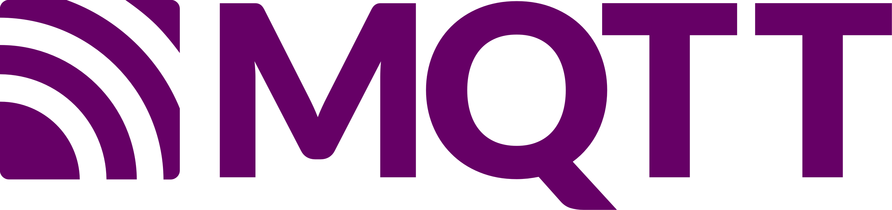
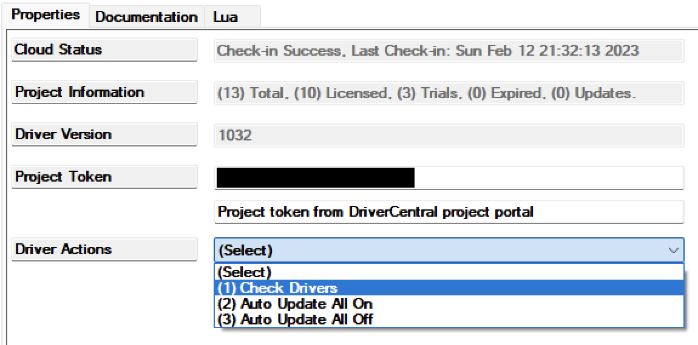

<!-- Copyright 2026 Finite Labs, LLC. All rights reserved. -->

______________________________________________________________________

# Overview

> DISCLAIMER: This software is neither affiliated with nor endorsed by either
> Control4 or MQTT.

The MQTT Broker driver connects Control4 to any MQTT broker. It manages the
connection and provides pub/sub services to child drivers that connect via the
MQTT broker connection binding.

## Driver Suite

The MQTT driver suite consists of two drivers:

| Driver             | Direction | Purpose                                                                                         |
| ------------------ | --------- | ----------------------------------------------------------------------------------------------- |
| **MQTT Broker**    | N/A       | Connection management to your MQTT broker                                                       |
| **MQTT Universal** | Inbound   | External MQTT device -> Control4 (create relays, contacts, buttons, variables from MQTT topics) |

**Typical Setup:**

1. Add the **MQTT Broker** driver and configure your broker connection
1. Add **MQTT Universal** if you need to bring external MQTT devices into
   Control4

# Index

- [System Requirements](#system-requirements)
- [Features](#features)
- [Installer Setup](#installer-setup)
  <!-- #ifdef DRIVERCENTRAL -->
  - [DriverCentral Cloud Setup](#drivercentral-cloud-setup)
  <!-- #endif -->
  - [Driver Installation](#driver-installation)
  - [Driver Setup](#driver-setup)
    - [Driver Properties](#driver-properties)
      - [Cloud Settings](#cloud-settings)
      - [Driver Settings](#driver-settings)
      - [Broker Settings](#broker-settings)
    - [Driver Actions](#driver-actions)
  - [Connections](#connections)
- [Programming](#programming)
  - [Events](#events)
  - [Conditionals](#conditionals)
  - [Commands](#commands)
  <!-- #ifdef DRIVERCENTRAL -->
- [Developer Information](#developer-information)
  <!-- #endif -->
- [Support](#support)
- [Changelog](#changelog)

# System Requirements

- Control4 OS 3.3+
- An MQTT broker accessible on the local network

# Features

- Local network communication requiring no cloud services
- Connects to any standard MQTT broker
- Supports username/password authentication
- Manages subscriptions for connected child drivers
- Automatic reconnection on disconnect
- Message caching for late-subscribing devices

# Installer Setup

<!-- #ifdef DRIVERCENTRAL -->

## DriverCentral Cloud Setup

> If you already have the
> [DriverCentral Cloud driver](https://drivercentral.io/platforms/control4-drivers/utility/drivercentral-cloud-driver/)
> installed in your project you can continue to
> [Driver Installation](#driver-installation).

This driver relies on the DriverCentral Cloud driver to manage licensing and
automatic updates. If you are new to using DriverCentral you can refer to their
[Cloud Driver](https://help.drivercentral.io/407519-Cloud-Driver) documentation
for setting it up.

<!-- #endif -->

## Driver Installation

<!-- #ifdef DRIVERCENTRAL -->

1. Download the latest `control4-mqtt.zip` from
   [DriverCentral](https://drivercentral.io/platforms/control4-drivers/utility/mqtt).

1. Extract and
   [install](https://www.control4.com/help/c4/software/cpro/dealer-composer-help/content/composerpro_userguide/adding_drivers_manually.htm)
   the `mqtt_broker.c4z` and `mqtt_universal.c4z` drivers.

1. Use the "Search" tab to find the "MQTT Broker" driver and add it to your
   project.

   > ⚠️ A **_single_** broker driver instance is required per broker you wish to
   > connect to.

1. Select the newly added driver in the "System Design" tab. You will notice
   that the `Cloud Status` reflects the license state. If you have purchased a
   license it will show `License Activated`, otherwise `Trial Running` and
   remaining trial duration. Without an active license or trial the broker
   disconnects five minutes after it loads and
   [`Driver Status`](#driver-status-read-only) shows `No active license`; it
   connects again as soon as a license is active.

1. You can refresh license status by selecting the "DriverCentral Cloud" driver
   in the "System Design" tab and perform the "Check Drivers" action.
    

1. Configure the [Broker Settings](#broker-settings) with the connection
   information.

1. After a few moments the [`Driver Status`](#driver-status-read-only) will
   display `Connected`. If the driver fails to connect, set the
   [`Log Mode`](#log-mode--off--print--log--print-and-log-) property to `Print`
   and run action [`Reconnect`](#reconnect) from the actions tab. Then check the
   lua output window for more information.

<!-- #else -->

1. Download the latest `control4-mqtt.zip` from
   [Github](https://github.com/finitelabs/control4-mqtt/releases/latest).

1. Extract and
   [install](https://www.control4.com/help/c4/software/cpro/dealer-composer-help/content/composerpro_userguide/adding_drivers_manually.htm)
   the `mqtt_broker.c4z` and `mqtt_universal.c4z` drivers.

1. Use the "Search" tab to find the "MQTT Broker" driver and add it to your
   project.

   > ⚠️ A **_single_** broker driver instance is required per broker you wish to
   > connect to.

1. Configure the [Broker Settings](#broker-settings) with the connection
   information.

1. After a few moments the [`Driver Status`](#driver-status-read-only) will
   display `Connected`. If the driver fails to connect, set the
   [`Log Mode`](#log-mode--off--print--log--print-and-log-) property to `Print`
   and run action [`Reconnect`](#reconnect) from the actions tab. Then check the
   lua output window for more information.

<!-- #endif -->

## Driver Setup

### Driver Properties

#### Cloud Settings

<!-- #ifdef DRIVERCENTRAL -->

##### Cloud Status (read-only)

Displays the DriverCentral cloud license status.

<!-- #endif -->

##### Automatic Updates \[ Off | **_On_** \]

<!-- #ifdef DRIVERCENTRAL -->

Turns on/off the DriverCentral cloud automatic updates. Changing it on any MQTT
Broker or MQTT Universal item changes it on all of them.

<!-- #else -->

Turns on/off the GitHub cloud automatic updates. Changing it on any MQTT Broker
item changes it on all of them.

##### Update Channel \[ **_Production_** | Prerelease \]

Sets the update channel for which releases are considered during an automatic
update from the GitHub repo releases. Changing it on any MQTT Broker item
changes it on all of them.

<!-- #endif -->

#### Driver Settings

##### Driver Status (read-only)

Displays the state of the connection to the broker:

- `Connecting...` while the driver waits for the broker to answer.
- `Connected` once the broker accepts the connection.
- `Connect failed: <reason>` when an attempt fails. The driver tries again.
- `Disconnected: <reason> (retrying)` when a connection drops. The driver tries
  again.
- `Disconnected` when the broker closes the connection cleanly. The driver does
  not try again until you run [`Reconnect`](#reconnect) or change a
  [Broker Setting](#broker-settings).
- `Not configured` while [`Broker Address`](#broker-address) is empty.
  <!-- #ifdef DRIVERCENTRAL -->
- `No active license` while the driver has no active license or trial.
  <!-- #endif -->

The driver waits 2 seconds before its first retry and doubles the wait after
each retry that fails, up to 30 seconds, so a broker that stays down is retried
every 30 seconds. The wait goes back to 2 seconds once a connection has stayed
up for two minutes.

##### Driver Version (read-only)

Displays the current version of the driver.

##### Log Level \[ 0 - Fatal | 1 - Error | 2 - Warning | **_3 - Info_** | 4 - Debug | 5 - Trace | 6 - Ultra \]

Sets the logging level. Default is `3 - Info`.

##### Log Mode \[ **_Off_** | Print | Log | Print and Log \]

Sets the logging mode. Default is `Off`.

<!-- #ifdef DRIVERCENTRAL -->

##### Support Code

Leave it blank unless Finite Labs support gives you a code: it opens Composer's
Lua tab to this driver for an hour.

##### Cloud Monitoring \[ Disabled | **_Enabled_** \]

When Enabled, the driver sends Finite Labs a short report once an hour, and a
report of each error it hits, at most 10 a minute. We use them to find and fix
problems in the driver. Set it to Disabled to send nothing.

A report holds the controller's MAC address and OS version, the driver's name,
version, device ID and DriverCentral license status, how much memory the driver
uses, and the sizes of its largest internal tables. An error report also holds
the error message and where in the driver it happened. Before a message is sent,
anything in it that looks like a password, token, key, network address or email
address is removed.

<!-- #endif -->

#### Broker Settings

##### Broker Address

Sets the broker's IP address. A host name also works when the controller can
resolve it. HTTPS is not supported.

> ⚠️ If you are using an IP address, you should ensure it will not change by
> assigning a static IP or creating a DHCP reservation.

##### Port \[ 1 - 65535, default: **_1883_** \]

Sets the port the broker listens on. Default is `1883`.

##### Username

Sets the username for broker authentication (optional).

##### Password

Sets the password for broker authentication (optional).

##### Keep Alive \[ 10 - 3600, default: **_60_** \]

Sets the keep-alive interval in seconds. Default is `60`.

### Driver Actions

<!-- #ifndef DRIVERCENTRAL -->

#### Update Drivers

Trigger all MQTT drivers to update from the latest release on GitHub, regardless
of the current version.

<!-- #endif -->

#### Reconnect

Closes the connection to the broker and connects again. Control4 programming can
do the same with the [`Reconnect`](#commands) command.

<!-- #ifdef DRIVERCENTRAL -->

#### Diagnostics Snapshot

Prints a report in the Lua output, and sends it to Finite Labs only while Cloud
Monitoring is Enabled.

<!-- #endif -->

## Connections

### MQTT Broker (provider)

Each MQTT Universal driver binds here to send and receive its messages through
this broker.

# Programming

## Events

| Event               | Description                                                                                                                                           |
| ------------------- | ----------------------------------------------------------------------------------------------------------------------------------------------------- |
| Broker Connected    | Fires when the driver connects to the MQTT broker.                                                                                                    |
| Broker Disconnected | Fires once when a connection to the MQTT broker ends, whether the broker drops it or the driver closes it. It does not fire again while retries fail. |

## Conditionals

| Conditional                   | Description                                                |
| ----------------------------- | ---------------------------------------------------------- |
| MQTT broker connection status | Tests whether the broker is `Connected` or `Disconnected`. |

## Commands

| Command   | Parameters | Description                                                                         |
| --------- | ---------- | ----------------------------------------------------------------------------------- |
| Reconnect | None       | Closes the connection to the broker and connects again, as the action of that name. |

<!-- #ifdef DRIVERCENTRAL -->

# Developer Information

Copyright © 2026 Finite Labs LLC

All information contained herein is, and remains the property of Finite Labs LLC
and its suppliers, if any. The intellectual and technical concepts contained
herein are proprietary to Finite Labs LLC and its suppliers and may be covered
by U.S. and Foreign Patents, patents in process, and are protected by trade
secret or copyright law. Dissemination of this information or reproduction of
this material is strictly forbidden unless prior written permission is obtained
from Finite Labs LLC. For the latest information, please visit
https://drivercentral.io/platforms/control4-drivers/utility/mqtt

<!-- #endif -->

# Support

<!-- #ifdef DRIVERCENTRAL -->

If you have any questions or issues integrating this driver with Control4 or
MQTT, you can contact us at
[driver-support@finitelabs.com](mailto:driver-support@finitelabs.com) or
call/text us at [+1 (949) 371-5805](tel:+19493715805).

<!-- #else -->

If you have any questions or issues integrating this driver with Control4, you
can file an issue on GitHub:

https://github.com/finitelabs/control4-mqtt/issues/new

<!-- #endif -->

<!-- #embed-changelog -->
